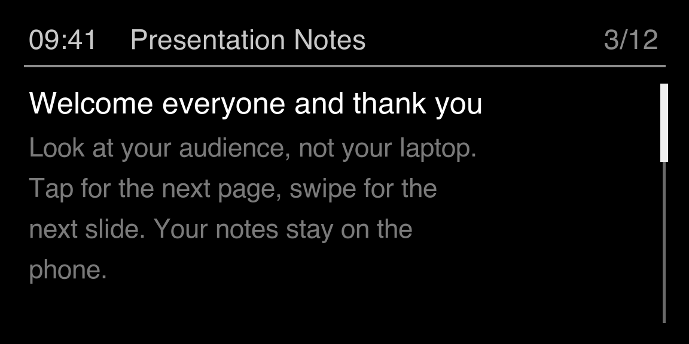
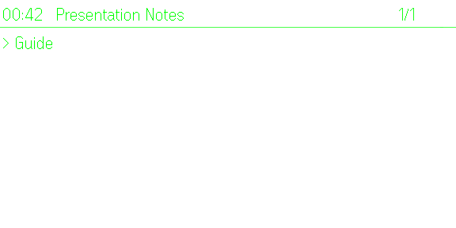
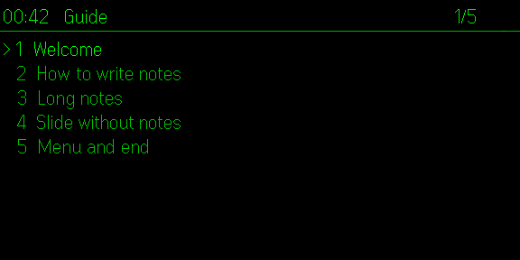
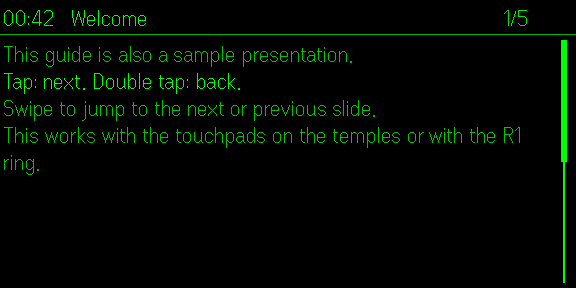
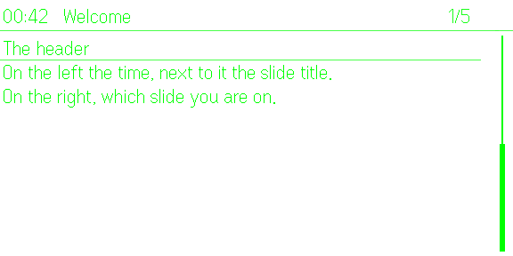
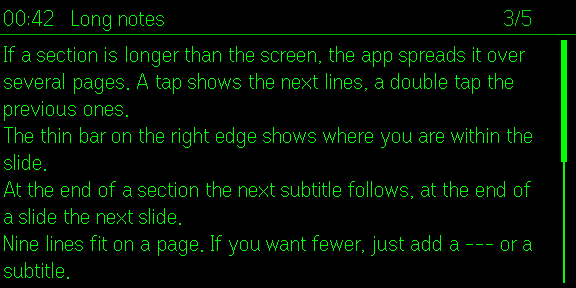
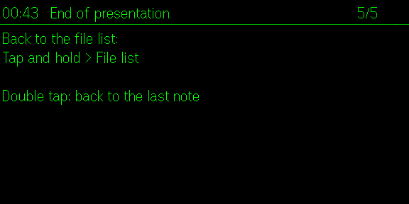

# Presentation Notes

**Your speaker notes on the G2, slide by slide**

A plugin for the [Even Realities G2](https://www.evenrealities.com/) smart glasses.

Presentation Notes shows your speaker notes on the Even Realities G2 glasses, slide by slide, so you can look at your audience instead of your laptop.

Write one Markdown file per presentation: every "# Title" starts a slide, "## Subtitle" starts a section, "---" starts a new page, and **bold** lines are shown bright while the rest of the page is dimmed. Import several files on your iPhone or write and edit them directly in the app.

On the glasses
- Header with the current time, the slide title and your position (3/12)
- Tap for the next page, double tap to go back, swipe to jump a whole slide; works with the touchpads on the temples and the R1 ring
- Long sections are split into pages; a slim bar on the right shows where you are within the slide
- Tap and hold for the menu: Slide list, File list, Exit app
- Remembers your position in every presentation

On the iPhone
- Live view of the glasses with a remote control
- Editor with an outline, the number of glasses pages per slide and a warning for characters the glasses cannot display
- A built-in guide that doubles as a sample presentation
- Phone app in 12 languages, glasses in 8

Private by design: your notes stay on your phone. Nothing is uploaded; the only network use is the optional feedback form.

## Get it

Presentation Notes is published in the **Even Hub**, the app store for the G2: [hub.evenrealities.com/catalogue](https://hub.evenrealities.com/catalogue). On your iPhone, open the Even Realities app, go to Even Hub and search for "Presentation Notes".

*The app is currently in review and appears in the catalogue once it is approved.*

## Screenshots

| | |
|---|---|
|  |  |
|  |  |
|  |  |

## Feedback and wishes

Use the feedback form in the app's settings, open an [issue](../../issues), or write to presentation-notes@networksfactory.com.

## Privacy

Your notes stay on your phone. See the [privacy policy](PRIVACY.md).

## Other languages

Deutsch

**Deine Sprechnotizen auf der G2, Slide für Slide**

Presentation Notes zeigt deine Sprechnotizen auf der Brille Even Realities G2, Slide für Slide. So schaust du dein Publikum an statt deinen Laptop.

Pro Vortrag eine Markdown-Datei: "# Titel" beginnt einen Slide, "## Untertitel" einen Abschnitt, "---" eine neue Seite, und **fette** Zeilen erscheinen hell, der Rest der Seite gedimmt. Importiere mehrere Dateien auf dem iPhone oder schreibe und bearbeite sie direkt in der App.

Auf der Brille
- Kopfzeile mit Uhrzeit, Slide-Titel und Position (3/12)
- Tippen blättert weiter, Doppeltippen zurück, Wischen springt einen ganzen Slide; mit den Touchpads an den Bügeln und mit dem R1 Ring
- Lange Abschnitte werden auf Seiten verteilt; eine schmale Leiste rechts zeigt, wo du im Slide stehst
- Tippen und gedrückt halten öffnet das Menü: Slide-Übersicht, Datei-Übersicht, App beenden
- Merkt sich die Position in jedem Vortrag

Auf dem iPhone
- Live-Ansicht der Brille mit Fernbedienung
- Editor mit Gliederung, Anzahl Brillen-Seiten pro Slide und Hinweis auf Zeichen, die die Brille nicht anzeigen kann
- Eingebaute Anleitung, die zugleich ein Beispielvortrag ist
- App in 12 Sprachen, Brille in 8

Datenschutz von Anfang an: Deine Notizen bleiben auf deinem Telefon. Nichts wird hochgeladen; das Netz nutzt nur das freiwillige Feedback-Formular.

Français

**Notes d'orateur sur les G2, à chaque diapositive**

Presentation Notes affiche vos notes d'orateur sur les lunettes Even Realities G2, diapositive par diapositive. Vous regardez votre public plutôt que votre ordinateur.

Un fichier Markdown par présentation : « # Titre » commence une diapositive, « ## Sous-titre » une section, « --- » une nouvelle page, et les lignes en **gras** ressortent en clair tandis que le reste de la page est atténué. Importez plusieurs fichiers sur votre iPhone, ou écrivez-les et modifiez-les directement dans l'app.

Sur les lunettes
- En-tête avec l'heure, le titre de la diapositive et votre position (3/12)
- Toucher pour la page suivante, double toucher pour revenir, glisser pour sauter une diapositive entière ; avec les pavés tactiles des branches et la bague R1
- Les longues sections sont réparties sur plusieurs pages ; une fine barre à droite indique où vous en êtes dans la diapositive
- Toucher et maintenir ouvre le menu : Diapositives, Fichiers, Quitter l'app
- Mémorise votre position dans chaque présentation

Sur l'iPhone
- Vue en direct des lunettes avec télécommande
- Éditeur avec plan, nombre de pages sur les lunettes par diapositive et avertissement pour les caractères que les lunettes ne peuvent pas afficher
- Un guide intégré qui sert aussi de présentation d'exemple
- App en 12 langues, lunettes en 8

Confidentialité dès la conception : vos notes restent sur votre téléphone. Rien n'est mis en ligne ; seul le formulaire d'avis, facultatif, utilise le réseau.

Español

**Tus notas en las G2, diapositiva a diapositiva**

Presentation Notes muestra tus notas de orador en las gafas Even Realities G2, diapositiva a diapositiva. Así miras a tu público y no a tu portátil.

Un archivo Markdown por presentación: «# Título» empieza una diapositiva, «## Subtítulo» una sección, «---» una página nueva, y las líneas en **negrita** se ven brillantes mientras el resto de la página se atenúa. Importa varios archivos en tu iPhone o escríbelos y edítalos directamente en la app.

En las gafas
- Cabecera con la hora, el título de la diapositiva y tu posición (3/12)
- Toque para la página siguiente, doble toque para volver, deslizar para saltar una diapositiva entera; con los paneles táctiles de las patillas y con el anillo R1
- Las secciones largas se reparten en páginas; una barra fina a la derecha muestra dónde estás dentro de la diapositiva
- Tocar y mantener abre el menú: Diapositivas, Archivos, Salir de la app
- Recuerda tu posición en cada presentación

En el iPhone
- Vista en directo de las gafas con mando a distancia
- Editor con esquema, número de páginas en las gafas por diapositiva y aviso de caracteres que las gafas no pueden mostrar
- Una guía integrada que también sirve de presentación de ejemplo
- App en 12 idiomas, gafas en 8

Privacidad desde el diseño: tus notas se quedan en tu teléfono. No se sube nada; solo el formulario de comentarios, opcional, usa la red.

Italiano

**Le tue note da relatore sui G2, slide dopo slide**

Presentation Notes mostra le tue note da relatore sugli occhiali Even Realities G2, slide dopo slide. Così guardi il pubblico e non il portatile.

Un file Markdown per presentazione: "# Titolo" inizia una slide, "## Sottotitolo" una sezione, "---" una nuova pagina, e le righe in **grassetto** appaiono luminose mentre il resto della pagina è attenuato. Importa più file sull'iPhone oppure scrivili e modificali direttamente nell'app.

Sugli occhiali
- Intestazione con ora, titolo della slide e posizione (3/12)
- Tocco per la pagina successiva, doppio tocco per tornare indietro, scorrimento per saltare un'intera slide; con i touchpad sulle aste e con l'anello R1
- Le sezioni lunghe vengono divise in pagine; una barra sottile a destra mostra dove ti trovi nella slide
- Tocca e tieni premuto per aprire il menu: Elenco slide, Elenco file, Esci dall'app
- Ricorda la posizione in ogni presentazione

Sull'iPhone
- Vista in diretta degli occhiali con telecomando
- Editor con struttura, numero di pagine sugli occhiali per slide e avviso per i caratteri che gli occhiali non possono mostrare
- Una guida integrata che è anche una presentazione di esempio
- App in 12 lingue, occhiali in 8

Privacy by design: le tue note restano sul telefono. Non viene caricato nulla; solo il modulo di feedback, facoltativo, usa la rete.

中文

**在 G2 上逐张显示你的演讲者备注**

Presentation Notes 在 Even Realities G2 眼镜上逐张幻灯片显示你的演讲者备注，让你看着观众，而不是笔记本电脑。

每个演示文稿一个 Markdown 文件：“# 标题”开始一张幻灯片，“## 小标题”开始一个部分，“---”开始新的一页，**粗体**行高亮显示，页面其余部分变暗。可以在 iPhone 上导入多个文件，也可以直接在应用中编写和编辑。

眼镜上
- 顶部栏显示当前时间、幻灯片标题和位置（3/12）
- 轻点翻到下一页，双击返回上一页，滑动跳转一整张幻灯片；支持镜腿上的触控板和 R1 戒指
- 较长的部分会分成多页；右侧细条显示你在当前幻灯片中的位置
- 轻点并按住打开菜单：幻灯片列表、文件列表、退出应用
- 记住每个演示文稿中的位置

iPhone 上
- 眼镜实时画面和遥控按钮
- 带大纲的编辑器，显示每张幻灯片在眼镜上的页数，并提示眼镜无法显示的字符
- 内置使用说明，同时也是示例演示文稿
- 手机应用支持 12 种语言，眼镜支持 8 种

隐私优先：你的备注只保存在手机上，不会上传。只有可选的反馈表单会使用网络。

